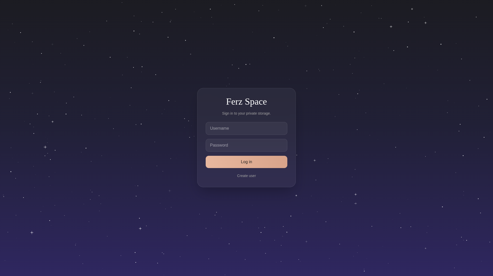

# Ferz Space

A private, self-hosted cloud drive for photos, videos and documents. Each user gets their own storage space, and an admin console manages accounts.

# Login page Screenshot


## Features

- Per-user login, with login rate limiting
- Upload photos, videos and documents (PDF, Word, Excel, PowerPoint, CSV, text, ODT; HEIC is converted to JPEG), with a top progress bar for uploads
- Search, sort, grid and list views, a photo and video viewer, in-page PDF/DOC/DOCX previews, and document downloads
- Multi-select with details and delete
- Storage quota per user, set by the admin
- Profile page where users can request a storage increase
- Create-user requests that an admin approves or rejects
- Admin console: users, all files, account requests, storage requests and an activity log

## Stack

- Backend: FastAPI, SQLite, Argon2 password hashing
- Frontend: React (Vite) and Tailwind CSS

## Document previews

PDF, DOC and DOCX files open read-only inside the drive's viewer. PDFs are rendered by the browser; DOC and DOCX are converted to PDF on the server with LibreOffice and cached in `previews/`.

Install LibreOffice Writer on the server:

```bash
# Debian / Ubuntu
sudo apt-get install -y --no-install-recommends libreoffice-writer

# Fedora
sudo dnf install -y libreoffice-writer
```

Without LibreOffice, PDF previews still work, but DOC/DOCX files show the download card instead.

## Run locally

```bash
# frontend
cd frontend
npm install
npm run build
cd ..

# backend
pip install fastapi uvicorn argon2-cffi slowapi pillow pillow-heif python-multipart itsdangerous
DEV=1 SESSION_SECRET="change-me" uvicorn main:app --host 127.0.0.1 --port 8000
```

Open `http://localhost:8000`. Use `create_user.py` to create the first admin account.

## Configuration

| Variable | Purpose |
|----------|---------|
| `SESSION_SECRET` | Required. A long random string used to sign sessions. |
| `DEV` | Set to `1` only for local HTTP testing. Leave unset in production. |
| `COOKIE_DOMAIN` | Session cookie domain. Defaults to `.ferz.co.in` in production so `ferz.co.in` and `drive.ferz.co.in` share the login. |

## Notes

- Uploads are stored in `storage/` and data in `app.db`.
